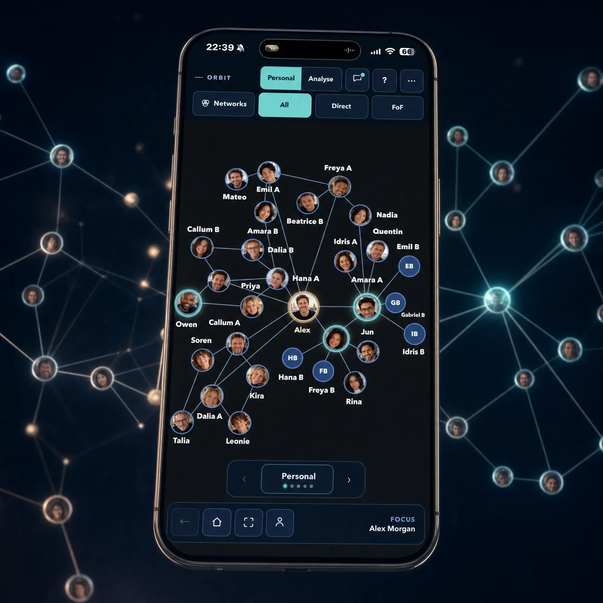

# 🌐 ORBIT
### A Graph-Native Social Networking Platform

**Reimagining how people discover, visualise and interact with their social networks.**

`Product Innovation` · `Graph Architecture` · `Next.js` · `TypeScript` · `Privacy Engineering` · `AI-Assisted Development`

---

## 🌍 Overview

ORBIT is an independent technology project exploring a fundamentally different approach to social networking.

Traditional social platforms organise interactions around linear feeds, profiles and content streams. ORBIT explores a **graph-native experience**, placing people, relationships and connections at the centre of the interface.

The vision is to create an intuitive, visually engaging environment where users can navigate their social world, discover connections and understand relationships through an interactive network.

Rather than simply scrolling through information, users explore a connected social universe.

**The central concept: Your network isn't a list. It's a world you can explore.**

---

## 🚀 Product Vision

ORBIT aims to introduce a more visual, intuitive and relationship-driven social networking experience.

The proposed experience begins with a cinematic, interactive globe that provides a geographical perspective on the user's social world.

As users navigate towards a location or community, the interface transitions into an interactive graph of relationships.

Connections become visible, networks can be explored and relationships can be understood spatially.

### Core Product Principles

**🌐 Visual Discovery**

An immersive globe-to-network experience, allowing users to explore their social world geographically and relationally.

**🔗 Graph-Native Navigation**

Relationships form the foundation of the user experience, rather than being secondary features of traditional profiles and feeds.

**🔍 Multiple Network Perspectives**

Users can explore relationships through different perspectives, including:

- **Direct Connections:** Explore immediate relationships.
- **Friends of Friends:** Understand wider relationship networks.
- **Geography:** Discover how connections relate to locations and communities.

**🔐 Privacy by Design**

Network visibility is governed by defined access rules, ensuring users can explore connections without automatically exposing private relationship information.

**📱 Cross-Platform Experience**

Designed with both web and mobile experiences in mind, with an emphasis on intuitive interaction and consistent visual design.

---

## 🏗️ Technology & Architecture

ORBIT is being developed using a modern web application architecture, with graph-oriented data structures and an emphasis on maintainability, performance and privacy.

### Technology Stack

| Technology | Application |
|---|---|
| Next.js | Web application framework |
| React | Component-based user interface |
| TypeScript | Type-safe application development |
| Node.js | JavaScript runtime and development tooling |
| Graph Data Modelling | Representation of users, connections and relationships |
| Git & GitHub | Version control and development management |
| Vitest | Automated testing |
| AI-Assisted Engineering | Implementation support, code analysis and development acceleration |

The architecture is being developed iteratively to support increasingly sophisticated graph interactions, network visualisation and user experiences.

### Architectural Considerations

Key design considerations include:

**Graph-Oriented Data Structures**

Representing users and relationships as connected entities, enabling network exploration beyond conventional lists and feeds.

**Viewer-Specific Data Projection**

Designing network responses around the permissions and visibility available to the requesting user.

**Separation of Concerns**

Distinguishing application presentation, domain logic, graph relationships and access controls.

**Performance & Scalability**

Considering the implications of graph traversal, rendering complexity and increasingly interconnected user populations.

**Modular Development**

Building components incrementally to support controlled testing, architectural evolution and maintainability.

*This public overview describes architectural principles rather than proprietary implementation details.*

---

## 🎨 User Experience & Interaction Design

ORBIT's user experience is intended to be a defining feature of the product.

The design direction combines elegant visualisation with intuitive network navigation.

### The Globe Experience

The proposed introductory experience presents users with an interactive globe representing their social world.

The interface is designed to support progressive geographical exploration, transitioning from a global perspective into increasingly localised networks.

### Interactive Network Navigation

At the relationship level, users interact with a two-dimensional graph of connected individuals.

The visualisation is intended to make complex social relationships understandable without overwhelming the user with unnecessary information.

### Visual Design Principles

- Clean, elegant interfaces.
- Minimal visual clutter.
- Intuitive relationship navigation.
- Progressive disclosure of network information.
- Responsive experiences across devices.
- Consistent, accessible interaction patterns.

The design process balances an ambitious visual experience with realistic technical delivery and performance considerations.

---

## 🔐 Privacy & Security Engineering

Privacy is a foundational architectural requirement.

A graph-based social network introduces particular challenges around relationship visibility, indirect connections and the disclosure of information through network traversal.

ORBIT's approach includes:

- Viewer-specific representations of network data.
- Explicit relationship visibility considerations.
- Separation between underlying graph information and user-accessible views.
- Privacy-aware handling of indirect connections.
- Automated testing of selected access and visibility behaviours.

### Viewer-Safe Graph Projection

An important architectural principle is that the information presented to a user should reflect their authorised view of the network.

This means the same underlying relationship graph may produce different visible results depending on who is accessing it.

The objective is to support meaningful exploration while maintaining appropriate control over personal and relationship information.

---

## 🧪 Engineering & Development Methodology

ORBIT follows a structured, iterative development approach.

Development activities include:

1. **Product Definition:** Establishing the product vision, user journeys and functional requirements.
2. **Architecture:** Defining core data structures, application boundaries and technical decisions.
3. **Implementation:** Developing functionality through modular, incremental changes.
4. **Testing:** Validating behaviour through automated tests and acceptance criteria.
5. **Review:** Evaluating implementation quality, architectural consistency and product outcomes.
6. **Iteration:** Refining the experience based on testing, technical findings and evolving product requirements.

### AI-Assisted Software Engineering

AI development tools are incorporated into the engineering workflow to accelerate implementation, support technical exploration and improve development efficiency.

The approach combines:

- Human-led product vision and strategic decisions.
- Defined technical requirements and acceptance criteria.
- AI-assisted coding and implementation.
- Automated testing and verification.
- Human review and approval of delivery outcomes.

The objective is to demonstrate how AI-enabled development can support disciplined software engineering and accelerate the transition from product concept to working prototype.

---

## 📈 Development Progress

ORBIT is an actively developed prototype.

### Initial Foundation

The initial development phase established:

- Core product vision and user journeys.
- Initial graph-oriented data structures.
- Viewer-safe network projection principles.
- Automated tests covering selected privacy and graph behaviours.
- Initial application framework and landing page.
- Version-controlled development workflow.

### Current Development Priorities

The ongoing development roadmap focuses on:

- Enhancing the visual network experience.
- Developing the globe-to-graph interaction model.
- Refining relationship navigation.
- Improving cross-device user experience.
- Expanding automated testing and validation.
- Preparing a compelling product demonstration.

The roadmap is managed iteratively, with functionality reviewed against defined requirements and acceptance criteria.

*Features described as proposed, planned or in development should not be interpreted as completed production capabilities.*

---

## 🎬 Product Demonstration

ORBIT is currently under active development.

This repository will be updated with selected demonstrations and visual materials as the prototype progresses.

Planned showcase materials include:

- Product interface screenshots.
- Globe-to-network navigation demonstrations.
- Interactive relationship visualisations.
- High-level architecture diagrams.
- Selected product design and development milestones.

**The application's source code is maintained in a separate private repository.**

---

## 🎯 Product & Technology Leadership

ORBIT is independently conceived and directed by **Ross Bell**, drawing on extensive experience in technology transformation, product strategy and enterprise solution delivery.

The project provides an opportunity to apply established product leadership disciplines directly to the design and development of an innovative software platform.

Key areas of focus include:

| Discipline | Application within ORBIT |
|---|---|
| Product Strategy | Vision, proposition development and roadmap |
| Solution Architecture | Application structure and technical design |
| Data Architecture | Graph-oriented relationship modelling |
| UX & Product Design | Visual navigation and user interaction |
| Privacy Engineering | Relationship visibility and access controls |
| Software Delivery | Incremental implementation and testing |
| AI-Enabled Engineering | AI-assisted development and validation |
| Delivery Governance | Requirements, acceptance criteria and milestone management |

ORBIT demonstrates the convergence of strategic product leadership, modern technology architecture and practical AI-enabled software development.

---

## 🔒 Intellectual Property & Repository Access

This repository is a **public project showcase** intended to communicate ORBIT's product vision, technical approach and development progress.

The core application source code, proprietary implementation details and commercially sensitive materials are maintained in private repositories.

Public documentation and demonstrations are selectively published to illustrate product development and engineering methodology without exposing the underlying intellectual property.

All rights reserved.

---

### 🌐 ORBIT
**Explore your world through connections.**

*An independent product innovation and technology development project by Ross Bell.*
